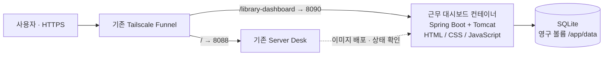

# 인천대학교 근무 대시보드 설계

구현 기준 문서. 현재 서비스는 아래 구조로 구현되었으며 운영 주소와 배포 방법은 README.md에서 확인한다.

## 선택한 구조

기존 HTML/CSS/JavaScript 화면과 Java Spring Boot API, SQLite를 하나의 Docker 컨테이너로 운영한다. 내장 Tomcat과 Java 21을 사용한다. 현재 근무자 7명의 시간표·연락처·인계 관리 규모를 기준으로 한다.



| 구성 | 선택 | 관리 방법 |
| --- | --- | --- |
| 화면 | 현재 시안의 HTML/CSS/JavaScript | 화면 코드를 재사용하고 API로 데이터를 읽고 저장 |
| API | Java 21 + Spring Boot | 기능별 라우트로 시간표·인적관리·이슈 처리 |
| 실행 | 내장 Tomcat, 최대 20 요청 스레드 | 컨테이너 안에서 화면과 API를 함께 제공 |
| DB | SQLite, SQLite JDBC 사용 | 로컬 Docker 볼륨의 DB 파일 하나 |
| HTTPS·경로 분기 | 기존 Tailscale Funnel | 인증서와 두 서비스의 접속 경로 담당 |
| 배포 | GHCR 이미지 → 기존 Server Desk | 버전별 이미지로 수동 배포부터 시작 |

별도 프런트엔드 빌드, Nginx, Redis, 별도 DB 컨테이너, 실시간 통신 서버는 초기 범위에 넣지 않는다. 화면은 탭을 열 때 데이터를 갱신하며, 이전·현재·다음 근무자는 한국 시간을 기준으로 자동 갱신한다.

## 공개 주소와 경로

요청한 철자와 대소문자를 그대로 사용한다.

```text
https://eatyummydance200.tail72d30b.ts.net/library-dashboard
```

끝에 `/`가 없는 주소로 들어오면 `/library-dashboard/`로 이동시킨다.

| 외부 경로 | 연결 대상 |
| --- | --- |
| `/` 및 기존 관리 API | 기존 Server Desk, `127.0.0.1:8088` |
| `/library-dashboard/` | 근무 대시보드 화면 |
| `/library-dashboard/static/...` | CSS, JavaScript, 공식 로고 |
| `/library-dashboard/api/...` | 근무 대시보드 API |
| `/library-dashboard/healthz` | 비밀값 없는 정상 여부 응답 |

Funnel은 하위 경로 프록시에서 mount 경로를 제거한다. 대상 URL에 동일한 경로를 포함해 복원하고, Spring servlet context-path도 같은 경로에 둔다. 예: 외부 `/library-dashboard/api/staff` → Funnel에서 `/api/staff` → 대상 URL 경로와 합쳐 내부 `/library-dashboard/api/staff`.

아래 설정으로 새 경로를 추가한다. 먼저 현재 Funnel 설정을 보관하고, 기존 루트 연결을 유지한다.

```bash
sudo tailscale funnel --bg --https=443 \
  --set-path=/library-dashboard \
  http://127.0.0.1:8090/library-dashboard
```

앱의 `APP_BASE_PATH=/library-dashboard`를 URL 생성의 기준으로 쓴다. 정적 파일, API, 로그인 이동 경로를 이 기준으로 생성하고 외부·내부 접속 모두 검사한다. 실제 Funnel을 통한 경로·리다이렉트 동작은 배포 때 검증해야 한다.

## 데이터와 핵심 규칙

DB는 `/app/data/library.sqlite3`. SQLite 외래키, WAL, 연결별 busy timeout을 적용하고 쓰기 작업은 짧은 트랜잭션으로 처리한다. 한 서버의 로컬 볼륨에서 사용하며 컨테이너를 여러 개로 늘리지 않는다.

| 데이터 | 필수 항목 |
| --- | --- |
| 근무자 | ID, 이름, 전화번호, 재직 여부 |
| 근무 구간 | ID, 근무자 ID, 근무일, 시작 분, 종료 분, 역할(데스크/일반) |
| 이슈 | ID, 해당 날짜, 구분, 제목, 내용, 작성 계정, 완료 여부, 생성·수정 시각 |
| 계정 | ID, 로그인 이름, 비밀번호 해시, 권한, 사용 여부, 세션 무효화용 버전 |

- 시간은 `09:00=540`, `16:30=990`처럼 자정부터의 정수 분으로 저장한다. 시작 포함·종료 제외 구간으로 계산하고, 같은 사람의 근무 시간이 겹치는 입력을 거절한다.
- 주간 시간표는 실제 날짜별로 저장한다. 이전 주 복사 기능으로 반복 입력을 줄이고, 이번 주 수정이 과거 주에 영향을 주지 않게 한다.
- 근무자 삭제 대신 재직 상태를 바꿔 과거 근무 기록을 유지한다.
- 주간 근무·데스크 시간은 근무 구간에서 계산한다. 오픈은 해당 날짜 09:00 근무자, 마감은 날짜별 마지막 종료 시각(최소 21:00)에 근무를 마친 사람을 한 번씩 센다.
- 이전·현재·다음은 모든 교대 시각을 기준으로 인접 근무 구간을 보여준다. 근무가 없는 시간과 주말도 처리한다.
- 날짜와 주간 경계는 `Asia/Seoul`, 기록의 생성·수정 시각은 UTC로 저장해 화면에서 한국 시간으로 표시한다.
- 기존 시안의 우측 통계는 첨부 이미지의 집계값이다. 서비스에서는 구간별 재계산 값과 원본을 대조한 뒤 초기 데이터를 확정한다.
- 과월호는 월별 추첨·수동 배정과 담당자 완료 체크를 제공하고, 태깅은 연도별 월간 완료 표로 관리한다.

## 로그인과 접근

관리자와 근무자 두 권한으로 시작한다. 관리자는 시간표·인적정보·계정을 수정하고, 근무자는 시간표·연락처를 조회하고 이슈를 작성·완료할 수 있도록 설계한다. 과월호 완료 체크는 연결된 본인 담당 항목만 가능하며, 관리자는 전체 항목을 처리할 수 있다.

모든 업무 화면과 API는 로그인이 필요하다. 비밀번호는 검증된 라이브러리의 해시 기능을 사용하고, 로그인 시도 제한과 쓰기 요청의 CSRF 검증을 적용한다. 입력 검증, SQL 파라미터 바인딩, 출력 이스케이프를 유지한다.

세션 쿠키 이름은 `library_dashboard_session`, 경로는 `/library-dashboard`, 속성은 Secure·HttpOnly·SameSite=Lax로 둔다. 서명 키는 Server Desk 환경변수로 전달하며 연락처·비밀번호를 로그에 남기지 않는다. 계정 비활성화나 비밀번호 변경 시 기존 세션을 무효화한다.

경로와 쿠키 이름을 나눠도 두 서비스는 같은 HTTPS 출처를 공유한다. 이는 보안 격리가 아니며, 한 서비스의 스크립트 취약점이 다른 서비스에 영향을 줄 수 있다. 강한 격리가 필요해지면 별도 호스트명으로 분리해야 한다.

## Server Desk 등록안

| 항목 | 값 |
| --- | --- |
| 이름 | `library-dashboard` |
| 이미지 | 생성할 프로젝트의 `ghcr.io/<owner>/<repository>:<version>` |
| 호스트 포트 | `8090` — 등록 직전 충돌 여부 재확인 |
| 컨테이너 포트 | `8000` |
| 접근 범위 | 서버 내부만, `127.0.0.1` |
| 상태 확인 | `/library-dashboard/healthz` |
| 영구 볼륨 | `data:/app/data` |
| 실제 볼륨 이름 | `sd-library-dashboard-data` |
| 환경변수 | `APP_BASE_PATH`, DB 경로, 세션 서명 키, 최초 관리자 설정 |
| 자동 배포 | 초기 꺼짐 |

컨테이너는 비관리자 사용자로 실행하며 데이터 디렉터리에만 쓸 수 있게 한다. Docker 소켓이나 호스트 루트 파일시스템을 새 서비스에 연결하지 않는다. 환경변수·DB 파일은 이미지에 포함하지 않는다.

## 수정·백업·복구

1. 수정 후 테스트를 통과한 이미지를 GHCR에 버전 태그로 게시한다. 기존 Server Desk의 빌드 워크플로 패턴을 재사용한다.
2. 스키마 변경 전 백업을 만들고, Server Desk에서 새 버전을 배포한다. DB 마이그레이션은 버전별 SQL로 관리하고 적용을 기록한다.
3. 상태 확인 및 로그인·시간표·저장 기능 확인 후 배포를 완료한다. 과거 DB를 바꾸는 변경은 이미지 롤백만으로 복구되지 않으므로 별도 복구 절차를 둔다.
4. SQLite backup API로 하루 한 번 일관된 스냅샷을 생성하고 최근 7일분을 보관한다. WAL 사용 중 DB 파일만 단순 복사하지 않는다. 인증된 관리자 백업 다운로드도 제공한다.
5. 동일 서버 안의 백업은 서버 디스크 고장을 보호하지 못하므로 별도 기기로 복사한다. 볼륨과 세션 서명 키의 복구도 함께 확인한다.

처음부터 자동 업데이트를 켜기보다, 수동 배포와 백업 복원을 검증한 뒤 자동화를 결정한다. 구체적인 메모리 사용량은 구현 후 측정한다.

## 구현 완료의 검증 기준

- 근무·데스크 합계, 30분 교대, 오픈·마감 횟수, 같은 사람의 겹친 근무 거절.
- 실제 주간 날짜, 주 복사, 과거 기록 보존, 한국 시간의 주간 경계.
- 로그인하지 않은 조회·수정 차단, 권한 검사, CSRF, 전화번호·이슈 출력 안전성.
- 컨테이너 재시작·새 이미지 배포 뒤 데이터 유지, DB 백업 복원.
- 실제 Funnel 주소에서 끝 슬래시, 정적 파일, API, 로그인 리다이렉트·쿠키 정상 동작.
- 기존 Server Desk의 화면·인증·API 정상 동작 유지.

## 근거 자료

- [Tailscale Funnel CLI: 하위 경로와 프록시 대상 지원](https://tailscale.com/docs/reference/tailscale-cli/funnel)
- [Tailscale 공식 프록시 구현: mount 접두 경로 제거](https://github.com/tailscale/tailscale/blob/main/ipn/ipnlocal/serve.go)
- [SQLite의 적합한 사용 범위와 동시 쓰기 제약](https://www.sqlite.org/whentouse.html)
- [SQLite의 일관된 백업 API](https://www.sqlite.org/backup.html)
- [Spring Boot 시스템 요구사항](https://docs.spring.io/spring-boot/3.5/system-requirements.html)
- 현재 서버의 `server-desk/README.md`, `AppSpec.java`, `Deployments.java` 및 조회한 Funnel 설정.
